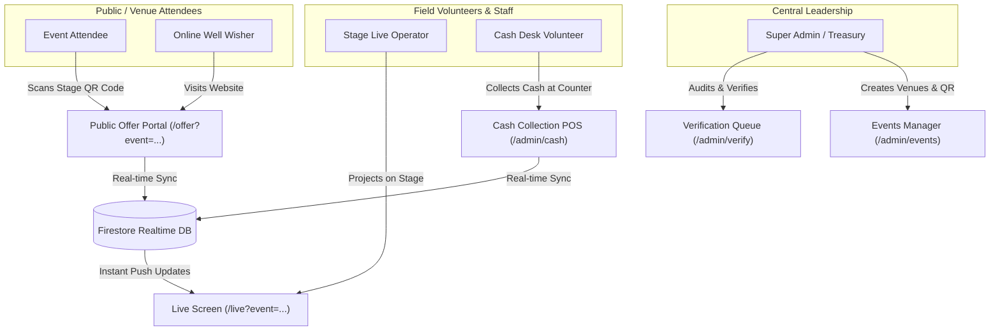
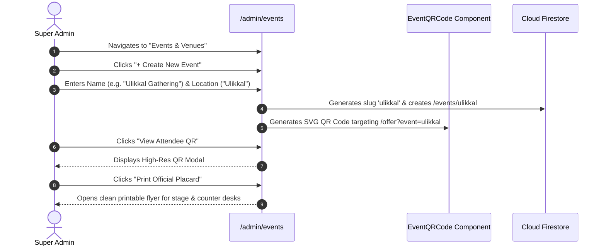
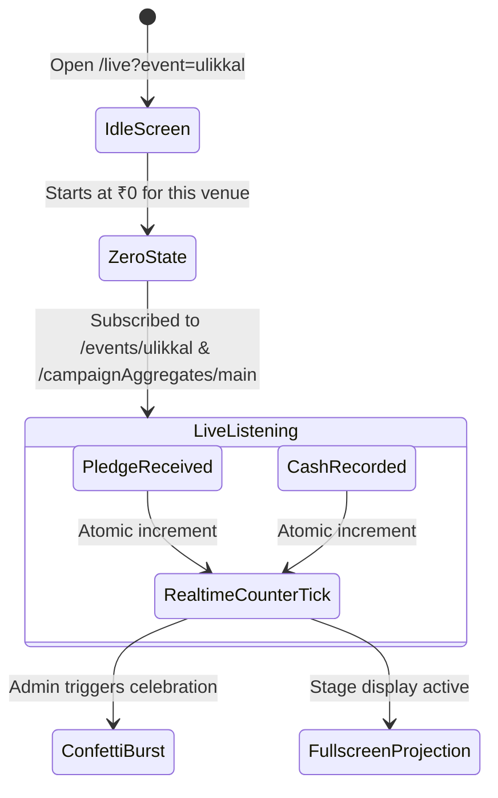
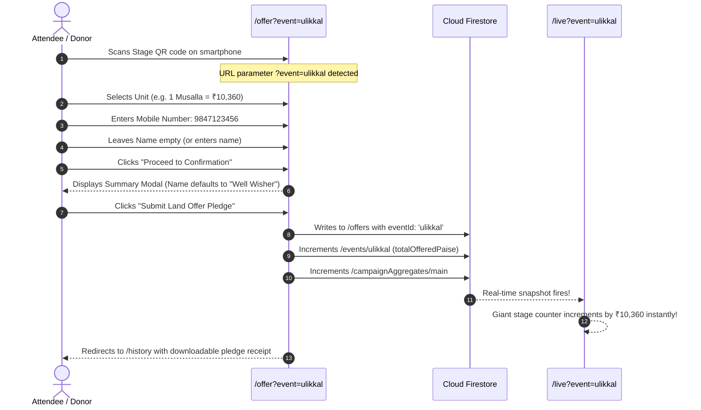
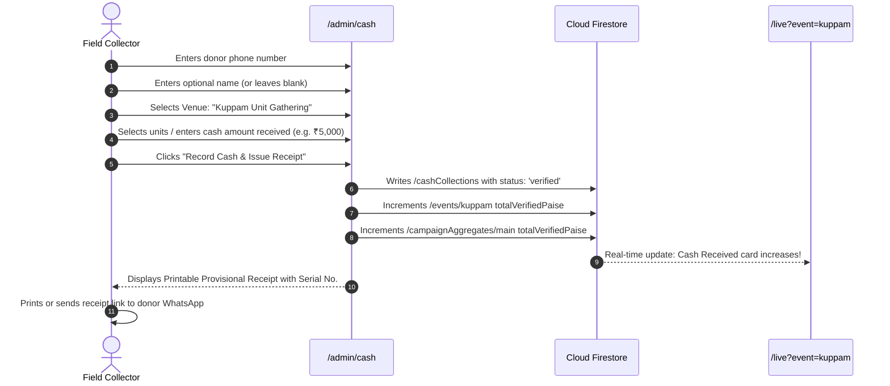
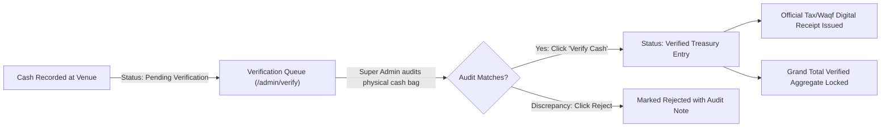

# Salafi Masjid Land Acquisition Platform — Comprehensive A to Z Workflow Guide

**Organization:** Wisdom Islamic Organization Kuppam Unit (*കുപ്പം യൂണിറ്റ്*)  
**Project:** Salafi Masjid 19.5 Cent Land Acquisition (*സലഫി മസ്ജിദ് സ്ഥലം ഏറ്റെടുക്കൽ പദ്ധതി*)  
**Campaign Target:** ₹1,10,00,000 (₹1.10 Crore)  
**Helpdesk / WhatsApp:** `+91 99477 48552`  

---

## 1. Executive Summary & Purpose

This platform is a specialized, real-time fundraising, live-event collection, and pledge-management system engineered for the **Wisdom Islamic Organization Kuppam Unit**.

The primary operational objective is to facilitate the acquisition of **19.5 Cents of land** for the Salafi Masjid in Kuppam, Taliparamba. The system functions both as a **public donation portal** and as an **event-driven live projection platform** for regional fundraising gatherings (e.g., Ulikkal, Kuppam, and other venue programs).

### Key Architectural Pillars
1. **Venue-Specific Live Screens:** Dedicated presentation screens (`/live?event=<id>`) designed for stage projectors. Each event starts at **₹0** and tallies collections for that venue only, while rolling up into the ₹1.10 Cr grand total.
2. **Dynamic Attendee QR Codes:** High-contrast QR codes rendered on stage projectors and printable placards, enabling attendees to scan and make land offers on their phones instantly.
3. **Phone Number as Primary Identifier:** In adherence to local community operational standards, a 10-digit mobile number is the sole mandatory ID. Contributor names are optional and default to **"Well Wisher" (സുമനസ്സ്)**.
4. **Pledge & Cash-in-Hand Mode:** No third-party payment gateway friction. Pledges, bank transfers, and direct cash collections are tracked, audited, and provisionally receipted on-site.
5. **Real-time Dual-Channel Sync:** Built on Google Cloud Firestore with real-time listeners (`onSnapshot`) ensuring that when cash is collected or a pledge is made, stage screens update with zero reload.

---

## 2. Core System Roles & Personas



### 1. Public Contributor / Attendee
- Accesses the public landing page (`/`) or scans the venue QR code (`/offer?event=<eventId>`).
- Selects land units (Cents, Sq. Ft., Musalla, or Custom Rupees).
- Submits contact details (Mobile number required; Name optional).
- Receives immediate acknowledgment and digital receipt link.

### 2. Stage / Live Screen Operator
- Opens `/live?event=<eventId>` on a stage laptop connected to an auditorium projector or LED wall.
- Operates full-screen mode without any distracting side-streams or personal donor data.
- Triggers confetti celebrations upon major milestone announcements.

### 3. Field Collection Volunteer (Cash POS)
- Uses a mobile phone, tablet, or laptop at the venue registration counter (`/admin/cash`).
- Searches existing donors by phone number or records new cash entries.
- Tags collections to the specific event venue.
- Issues an immediate provisional receipt with date, timestamp, and unique serial number.

### 4. Super Admin / Treasury Auditor
- Operates `/admin` and `/admin/verify`.
- Manages venues and downloads high-resolution printable QR codes (`/admin/events`).
- Cross-audits field cash against physical treasury envelopes and officially approves collections.
- Exports transaction ledgers to CSV for committee audits.

---

## 3. Unit Pricing & Land Calculation Matrix

All monetary calculations in the codebase are strictly performed in **paise** (integers) to eliminate JavaScript floating-point rounding errors.

| Unit Type | Unit Rate | Land Equivalent | Example Packages |
| :--- | :--- | :--- | :--- |
| **Cent** | ₹5,64,103 / Cent | ~435.6 Sq. Ft. | 0.5 Cent, 1 Cent, 2 Cent |
| **Square Feet (Sq. Ft.)** | ₹1,295 / Sq. Ft. | 1 Square Foot | 10, 25, 50, 100, 200 Sq. Ft. |
| **Musalla (Prayer Space)** | ₹10,360 / Musalla | 8 Square Feet | Single (₹10,360), 5-Musalla Family Pack (₹51,800) |
| **Custom Amount** | Configurable (Min ₹100) | Pro-rata general contribution | Quick chips: ₹500, ₹1k, ₹5k, ₹10k, ₹25k, ₹50k |

*Total Land Target:* **19.5 Cents (~8,494.2 Sq. Ft.)**  
*Total Financial Target:* **₹1,10,00,000 (₹1.10 Cr)**

---

## 4. End-to-End Workflows (A to Z)

### Workflow 1: Program / Venue Creation & QR Code Setup



1. **Access:** Super Admin opens `/admin/events`.
2. **Form Entry:** Enters Event Name (e.g., *Ulikkal Event*, *Kuppam Unit Gathering*) and Location.
3. **URL Generation:** The system assigns a unique identifier (`eventId`) and generates:
   - **Live Screen URL:** `https://domain.com/live?event=ulikkal`
   - **Offer URL:** `https://domain.com/offer?event=ulikkal`
4. **QR Code Generation:** An on-the-fly vector QR code is created using `qrcode.react`.
5. **Physical Distribution:** Admin copies the direct links or prints the high-resolution QR placards to place on venue tables and registration desks.

---

### Workflow 2: Stage Projector Screen Operation (`/live`)



1. **Launch:** Stage crew opens `/live?event=ulikkal` and clicks the **Fullscreen** icon (`Maximize2`).
2. **Initial State:** The giant central counter shows **₹0**, dedicated specifically to this event.
3. **Header Details:** Shows the venue tag (*📍 ULIKKAL EVENT*), live digital clock, and organization banner (*Wisdom Islamic Organization Kuppam Unit*).
4. **On-Screen Attendee QR Code:** Positioned prominently beside the giant counter:
   - Contains a direct scan link to `/offer?event=ulikkal`.
   - Text banner: **സ്കാൻ ചെയ്ത് ഓഫർ ചെയ്യുക (Scan to make a Land Offer)**.
5. **Dual Sub-Cards:**
   - **Cash Received at Venue:** Direct verified cash handed to counter volunteers.
   - **Pledged Balance:** Outstanding amount promised by attendees for upcoming fulfillment.
6. **Bottom Grand Total Bar:**
   - Compact status line showing total campaign progress: e.g. **₹42,34,500 / ₹1,10,00,000 (19.5 Cents)**.
   - Slim progress bar with percentage complete and remaining balance.

---

### Workflow 3: Attendee Mobile Land Offer Flow (`/offer`)



1. **Scan & Land:** Attendee scans the QR code from the live screen or a paper leaflet. The page loads with the venue pre-tagged (`?event=ulikkal`).
2. **Category Selection:** User taps one of the unit tabs:
   - **Cent:** Stepper for 1, 2, 3+ Cents.
   - **Sq. Ft.:** Direct input or quick buttons (10, 25, 50, 100, 200 Sq. Ft.).
   - **Musalla:** Stepper or 5-Musalla Family Pack button.
   - **Custom:** Free amount input with quick chips (₹1,000, ₹5,000, ₹10,000, etc.).
3. **Identity Input:**
   - **Name:** Optional. If empty, the system automatically registers the offer under **"Well Wisher" (സുമനസ്സ്)**.
   - **Mobile Number:** Required 10 digits (WhatsApp enabled).
4. **Pledge Execution:** User submits the pledge.
5. **Reactivity:** 
   - Firestore atomically updates the venue document `/events/ulikkal` and grand aggregate document `/campaignAggregates/main`.
   - The stage screen jumps in real time without refreshing.
   - User's browser caches the offer in `localStorage` for offline session persistence.

---

### Workflow 4: Field Cash Collection POS (`/admin/cash`)



1. **Desk Collection:** Attendee approaches the cash counter at the event and hands over physical currency.
2. **Quick Entry:** Volunteer enters:
   - Mobile number (e.g., `9947748552`).
   - Contributor name (optional).
   - Assigns to the active event dropdown (e.g., *Ulikkal Event*, *Kuppam Unit Gathering*).
   - Quantity and unit type (or custom cash amount).
3. **Receipt Generation:** Submitting instantly generates a formal provisional receipt:
   - Unique Serial Number: `CASH-2026-XXXX`.
   - Acting Collector: `Ajnas (Super Admin)` or authorized operator.
   - Direct link to digital printable receipt.
4. **Instant Sync:** The stage projector screen immediately increases its "Cash Received" tally.

---

### Workflow 5: Treasury Verification & Audit (`/admin/verify`)



1. **Segregation of Duties:** Field collectors log cash as received. Super admins audit before physical bank deposit.
2. **Queue Interface:** Super admin navigates to `/admin/verify`.
3. **Inspection:** Displays:
   - Receipt Number.
   - Contributor Name (or *Well Wisher*).
   - Amount in INR.
   - Field Collector name and venue reference notes.
4. **1-Click Audit:** Clicking **"Verify Cash"** updates the record status to `verified`, stamping the super admin's UID and timestamp.
5. **Receipt Issuance:** Automatically issues the final verified digital receipt.

---

### Workflow 6: Digital Receipts & WhatsApp Sharing (`/receipt/[id]`)

1. **Receipt View:** Navigating to `/receipt/<receiptId>` displays an official digital certificate.
2. **Header:** Features the circular Wisdom Islamic Organization Kuppam Unit emblem and registration details.
3. **Itemization:**
   - Contributor name (or *സുമനസ്സ് / Well Wisher*).
   - Pledged / contributed unit breakdown (e.g., *1 Cent @ ₹5,64,103*).
   - Amount in numeric INR and words (*Rupees Five Lakh Sixty Four Thousand One Hundred Three Only*).
   - Official Authorized Signatory stamp for the Kuppam Unit.
4. **WhatsApp Dispatch:** Contains a 1-click **"Share via WhatsApp"** button linking to `https://wa.me/919947748552` with pre-filled acknowledgment text.

---

## 5. Database Schema & Data Architecture

```
Firestore Database
 ├── campaignAggregates/
 │    └── main
 │         ├── totalOfferedPaise: number (Pledges + Cash)
 │         ├── totalVerifiedPaise: number (Treasury approved)
 │         ├── totalCashPaise: number
 │         ├── totalOnlinePaise: number
 │         ├── offerCount: number
 │         └── updatedAt: timestamp
 │
 ├── events/
 │    └── {eventId} (e.g. 'ulikkal', 'kuppam')
 │         ├── name: string ("Ulikkal Event")
 │         ├── location: string ("Ulikkal")
 │         ├── totalOfferedPaise: number (Venue total)
 │         ├── totalVerifiedPaise: number (Venue cash received)
 │         ├── offerCount: number
 │         └── updatedAt: timestamp
 │
 ├── offers/
 │    └── {offerId}
 │         ├── contributorName: string ("Well Wisher" if empty)
 │         ├── contributorPhone: string ("9947748552")
 │         ├── offerType: "cent" | "sqft" | "musalla" | "custom"
 │         ├── quantity: number
 │         ├── totalOfferedPaise: number
 │         ├── paidPaise: number
 │         ├── eventId: string ("ulikkal" | "general")
 │         ├── eventName: string
 │         ├── status: "pledged" | "verified" | "cancelled"
 │         └── createdAt: timestamp
 │
 └── cashCollections/
      └── {collectionId}
           ├── receiptNumber: string ("CASH-2026-1042")
           ├── contributorName: string ("Well Wisher" if empty)
           ├── contributorPhone: string ("9947748552")
           ├── amountPaise: number
           ├── collectorName: string ("Ajnas")
           ├── eventId: string ("ulikkal")
           ├── eventName: string
           ├── status: "pending_verification" | "verified"
           └── createdAt: timestamp
```

---

## 6. Security & Fallback Mechanics

1. **Firestore Security Rules:** Configured in `firestore.rules`:
   - Public read access for campaign aggregates, event totals, and live screen tallies.
   - Public create access for offers with client input validation.
   - Admin-only write access for status modifications and verification approvals.
2. **Network Resilience (Local Cache):**
   - In case of venue internet dropouts, submissions are preserved in browser `localStorage` (`masjid_user_offers`, `masjid_cash_collections`) so volunteers never lose an entry.
3. **URL Parameter Resiliency:**
   - Components reading query params (`?event=...`) are wrapped in Next.js `<Suspense>` boundaries to guarantee zero hydration mismatch during server-side pre-rendering.

---

## 7. Quick Reference: System Routes & Links

| Route | Purpose | Target Audience |
| :--- | :--- | :--- |
| **`/`** | Public Campaign Landing Page & Overview | Public / All Donors |
| **`/offer`** | General Land Offer Pledge Flow | General Public |
| **`/offer?event=<id>`** | Venue-Tagged Land Offer (via QR Scan) | Program Attendees |
| **`/live`** | Default Projector Screen (Ulikkal Event) | Auditorium Stage |
| **`/live?event=<id>`** | Venue-Specific Live Projector Screen | Auditorium Stage |
| **`/admin`** | Executive Financial Dashboard & Analytics | Admins & Leaders |
| **`/admin/events`** | Event Creation, Live Links & Attendee QR Codes | Admins & Event Coordinators |
| **`/admin/cash`** | Field Cash Collection POS & Provisional Receipts | Counter Volunteers |
| **`/admin/verify`** | Audit Queue for Physical Treasury Approval | Super Admin |
| **`/admin/offers`** | Master Ledger of all Pledges & Transactions | Super Admin |
| **`/receipt/[id]`** | Official Verified Waqf Digital Receipt | Donors & Audit Teams |
